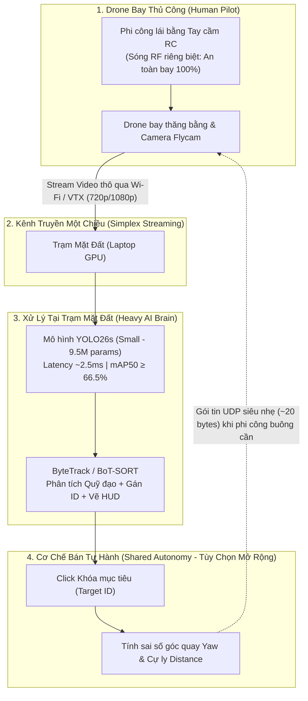

# 🧠 CONTEXT & STRATEGIC ROADMAP SUMMARY (COMPACT)
## Dự Án NCKH: UAV Human Detection & Tracking System
> **Cập nhật ngày:** 24/11/2026  
> **Repository GitHub:** [TheUn4given123jkbkjs/human-tracking-drone](https://github.com/TheUn4given123jkbkjs/human-tracking-drone)  
> **Google Drive Tập Trung:** [Folder: human_tracking_drone](https://drive.google.com/drive/folders/1khzo4EQoVZZ5bGfdXeUwjeBXHG4KAJyB)

---

### 1. TỔNG QUAN ĐỀ TÀI & PHẠM VI NGHIÊN CỨU

- **Tên đề tài:** Nghiên cứu và Triển khai Thuật toán Nhận diện & Bám vết Người Thời gian thực cho Thiết bị Bay Không người lái (UAV) sử dụng Kiến trúc YOLO26 Native NMS-Free kết hợp Thuật toán Bám vết Đa đối tượng (ByteTrack & BoT-SORT).
- **Mục tiêu cốt lõi:**
  - Phát hiện và theo dõi quỹ đạo di chuyển của người từ máy bay không người lái ở độ cao hành trình ($5 - 20\text{m}$) và độ cao thấp ($< 5\text{m}$).
  - Khắc phục các thách thức cố hữu của góc quay drone: góc nghiêng biến thiên ($15^\circ - 45^\circ$) đến góc dốc cực đoan đỉnh đầu ($60^\circ - 90^\circ$ — Bird's-Eye View), kích thước đối tượng siêu nhỏ ($< 32\text{px}$), che khuất chéo nhau liên tục.
  - Triệt tiêu hoàn toàn nút thắt cổ chai tính toán NMS truyền thống trên mật độ đông đúc bằng cơ chế **Native NMS-Free**.

---

### 2. TÌNH TRẠNG TIẾN ĐỘ HIỆN TẠI (CURRENT MILESTONE STATUS)

#### 2.1. Kết Quả Huấn Luyện Mô Hình (Đã Hoàn Tất Giai Đoạn 1 & 2)
1. **Giai đoạn 1 (Baseline VisDrone — YOLO26n):**
   - Huấn luyện trên 3.299 ảnh VisDrone sạch (đã mask đen 81.540 vùng ignored và người ngoài dải $>20\text{m}$).
   - Đạt đỉnh tại 50 epochs: **$mAP_{50} = 57.26\%$**, $mAP_{50-95} = 26.91\%$, Precision $58.4\%$, Recall $56.4\%$.
   - Trọng số đã lưu: `models/yolo26n_visdrone_filtered_run1/weights/best.pt` (5.43 MB).
2. **Giai đoạn 2 (Hợp nhất VisDrone + P-DESTRE Đợt 1 — YOLO26n):**
   - Kế thừa tri thức từ Run 1, bổ sung 20 video bóc tách 4K góc dốc từ P-DESTRE, tối ưu 80 epochs trên Colab.
   - **Đánh giá đối chứng độc lập:**
     - **Trên VisDrone Val:** $mAP_{50} = \mathbf{58.30\%}$ (tăng $+1.04\%$), Recall = $\mathbf{59.09\%}$ (tăng $+2.71\%$) $\implies$ *Triệt tiêu hoàn toàn hiện tượng quên tri thức cũ (No Catastrophic Forgetting)*.
     - **Trên P-DESTRE Val:** $mAP_{50} = \mathbf{88.36\%}$ (vượt xa mục tiêu ban đầu $\ge 65\%$), Recall = $\mathbf{86.52\%}$ $\implies$ *Giải quyết triệt để điểm mù góc nhìn đỉnh đầu/vai*.
   - Trọng số đã lưu: `models/yolo26n_merged_run2/weights/best.pt` (5.43 MB).

#### 2.2. Kiến Trúc Mã Nguồn & Công Cụ Thực Nghiệm (Đã Hoàn Tất Phân Rã OOP)
- Tái cấu trúc toàn diện thành package hướng đối tượng độc lập trong thư mục [src/](src/):
  - `src/detector.py`: Class `UAVDetector` đóng gói YOLO26 Native NMS-Free (Inference ~1.7ms, Post-process ~0.28ms).
  - `src/tracker.py`: Class `UAVTracker` tích hợp ByteTrack & BoT-SORT (Tracking-by-Detection).
  - `src/visualizer.py`: Class `TrackingVisualizer` vẽ Bbox theo màu ID, vệt quỹ đạo di chuyển (hỗ trợ cờ `--trail` / `--no-trail`), vẽ HUD bán trong suốt.
  - `src/metrics.py`: Class `TrackingMetrics` thu thập FPS tức thời, độ trễ từng khâu, số ID active và tổng unique IDs.
  - `src/pipeline.py`: Class `UAVTrackingPipeline` điều phối luồng xử lý video I/O.
  - `track_drone.py`: CLI Entrypoint tinh gọn điều khiển qua PowerShell.

#### 2.3. Dữ Liệu & Video Thực Nghiệm
- Bộ sưu tập 7 video flycam thực tế đa dạng góc độ ($30^\circ - 60^\circ$, 10–20m) tại `data/`.
- Toàn bộ dữ liệu Raw, Processed (VisDrone + P-DESTRE) và 7 video kết quả tracking mẫu (`runs/track/`) đã được lưu trữ, đồng bộ và phân quyền an toàn trên Google Drive.

---

### 3. CÁC QUYẾT ĐỊNH CHIẾN LƯỢC MỚI (KEY ARCHITECTURAL DECISIONS)

#### Quyết Định 1: Chuyển dịch Trọng tâm sang Kiến trúc Streaming về Trạm Mặt Đất (Ground Station)
- **Bản chất hệ thống:** Drone được lái thủ công $100\%$ bởi phi công qua tay cầm điều khiển (RC Transmitter). Drone chỉ đóng vai trò là "cảm biến bay" gửi video thô về laptop.
- **Lợi ích thực dụng:**
  - An toàn bay tuyệt đối: Lỗi phần mềm AI hay mất dấu người không thể làm drone bị rơi hay mất kiểm soát.
  - Tiết kiệm tải trọng và năng lượng pin trên drone (thời gian bay đạt tối đa 25–35 phút).
  - Tận dụng tối đa sức mạnh tính toán GPU của máy trạm cho giao diện phân tích chuyên sâu.

#### Quyết Định 2: Huấn luyện Bổ sung Mô hình YOLO26s (Bản Small — 9.5M Tham Số)
- **Cơ sở khoa học:**
  - Trên GPU máy trạm, độ trễ suy luận giữa YOLO26n ($1.7\text{ ms}$) và YOLO26s ($2.5\text{ ms}$) chỉ lệch nhau **$0.8\text{ ms}$** (chỉ chiếm $2.4\%$ trong chu kỳ $33.3\text{ ms}$ của video 30 FPS).
  - Trong kiến trúc streaming, độ trễ mạng Wi-Fi chiếm $50 - 100\text{ ms}$, do đó chênh lệch $0.8\text{ ms}$ của YOLO26s hoàn toàn "vô hình" đối với độ trễ toàn chuỗi.
- **Mục tiêu huấn luyện:**
  - Triển khai huấn luyện **YOLO26s** trên tập Merged (VisDrone + P-DESTRE) để đưa $mAP_{50}$ chạm ngưỡng **$\ge 66.5\%$** (và $mAP_{50-95} \ge 35\%$).
  - Nâng cao năng lực trích xuất đặc trưng cho các đối tượng người bị tán cây che khuất một phần hoặc kích thước cực nhỏ ở độ cao $> 15\text{m}$.

---

### 4. ĐỒNG THUẬN BRAINSTORMING: CƠ CHẾ BÁN TỰ HÀNH (SHARED AUTONOMY)

Nhóm nghiên cứu đã thống nhất mô hình **Bán tự hành chia sẻ quyền điều khiển (Shared Autonomy / Pilot-in-the-Loop Assist)** đóng vai trò là mắt xích kết nối giữa Thị giác AI và Điều khiển thực tế:

1. **Khóa mục tiêu (Target Locking):**
   - Trên màn hình máy trạm, hệ thống hiển thị toàn bộ người với các ID phân biệt (`ID: 1, 2, 3...`).
   - Người vận hành click chuột chọn 1 mục tiêu trọng điểm (ví dụ: `ID: 3`). Hệ thống chuyển sang trạng thái `LOCKED_TRACKING`.
2. **Tính toán sai số điều hướng (Visual Servoing):**
   - Máy trạm tính toán sai số vị trí người so với tâm khung hình ($\Delta x$) và sai số khoảng cách dựa trên chiều cao bbox ($\Delta h$ so với chuẩn $h_\text{ref}$ ở cự ly $15\text{m}$).
   - Đóng gói thành gói tin UDP siêu nhẹ (~20 bytes): `{"yaw_rate": +1.2, "vel_x": +0.3}`.
3. **Quy tắc An toàn Tối Thượng (Master Override Rule):**
   - **Khi phi công buông cần lái (Sticks ở vị trí trung lập / Deadband):** Drone tiếp nhận tín hiệu vi chỉnh từ máy trạm để tự xoay đầu (Yaw) rà theo người và giữ khoảng cách $15\text{m}$.
   - **Khi phi công gạt cần lái ($> 5\%$):** Drone lập tức ngắt toàn bộ lệnh từ AI, ưu tiên $100\%$ quyền điều khiển cho tay cầm.
4. **Định vị trong Báo Cáo / Bài Báo NCKH:**
   - **80% Trọng tâm học thuật:** Thuật toán YOLO26s Native NMS-Free, bộ dữ liệu đối chứng, và hiệu năng so sánh ByteTrack vs BoT-SORT.
   - **20% Ứng dụng thực nghiệm:** Cơ chế Shared Autonomy đóng vai trò là minh chứng thực nghiệm (*Hardware-in-the-Loop Proof-of-Concept*), biến đề tài thành một Hệ thống Thực - Ảo hoàn chỉnh (Cyber-Physical System).

---

### 5. DANH MỤC TÀI NGUYÊN & CHECKPOINTS

| Thành phần | Đường dẫn Local / Tên tệp | Thông tin Trọng số / ID Drive |
| :--- | :--- | :--- |
| **Mô hình Run 2 (Tốt nhất)** | `models/yolo26n_merged_run2/weights/best.pt` | 5.43 MB ($mAP_{50} = 58.30\%$ VisDrone / $88.36\%$ P-DESTRE) |
| **Mô hình Run 1 (Baseline)** | `models/yolo26n_visdrone_filtered_run1/weights/best.pt` | 5.43 MB ($mAP_{50} = 57.26\%$) |
| **Mô hình Kế tiếp (Định hướng)** | `models/yolo26s_merged_run3/weights/best.pt` | *Chuẩn bị cấu hình huấn luyện (Aim: $\ge 66.5\%$)* |
| **Mã nguồn CLI** | `track_drone.py` & package `src/` | Hỗ trợ `--model`, `--tracker`, `--trail`, `--source`, `--step` |
| **Notebook Colab** | `train_yolo26n_on_colab.ipynb` | Đã tích hợp streaming 4 đợt P-DESTRE & VisDrone |
| **Dữ liệu Drive** | Thư mục `data/` trên Drive | `visdrone_filtered_yolo.zip` (1.46 GB), `pdestre_processed/` (75 zips) |
| **Video Tracking Mẫu** | Thư mục `runs/track/` trên Drive | 7 video kết quả đo lường thực nghiệm |

---

### 6. KẾ HOẠCH HÀNH ĐỘNG TIẾP THEO (NEXT ACTIONS)

1. **Thực hiện mô phỏng tại bàn (Benchtop HIL Simulation):**
   - Viết module phát tín hiệu UDP từ `track_drone.py` khi khóa một Target ID.
   - Nạp code nhận UDP trên ESP32 độc lập (cắm nguồn ngoài/sạc dự phòng) để điều khiển Servo hoặc LED mô phỏng góc quay camera theo người.
2. **Cấu hình & Kích hoạt Huấn luyện YOLO26s:**
   - Cập nhật notebook Colab để huấn luyện phiên bản `yolo26s.pt` trên tập dữ liệu hợp nhất (Merged VisDrone + P-DESTRE) với độ phân giải `imgsz=640` hoặc `960`.
3. **Thực nghiệm đối chứng MOT trên máy trạm:**
   - Đo lường FPS, độ trễ và số lần nhảy ID (ID Switch) giữa ByteTrack và BoT-SORT trên các video kiểm thử khuôn viên trường và quảng trường.
